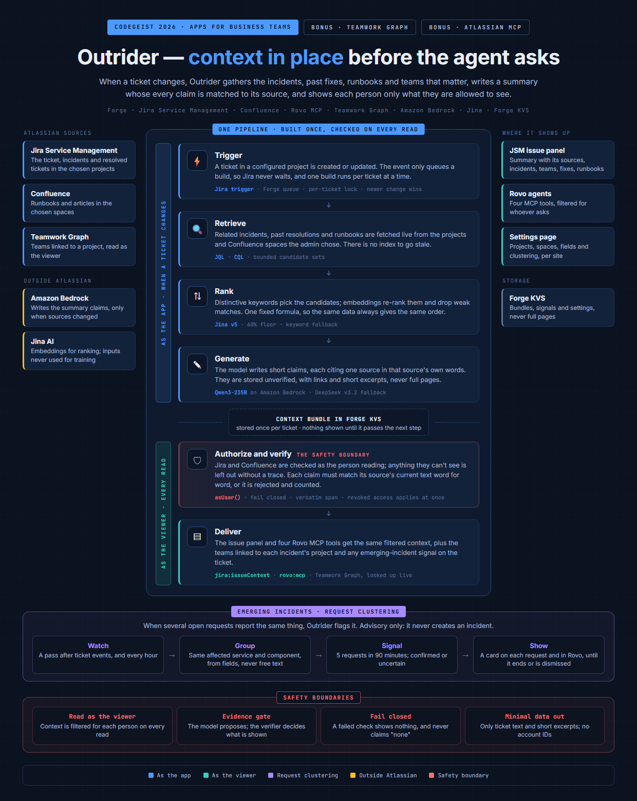

# Outrider

> Sent ahead. Context in place.

**An agent opening a service desk ticket usually starts blind.** The incident already open for the same outage, the
fix someone applied last month, the runbook, the team that owns the system: it all exists, spread across Jira,
Confluence and people's heads.

Outrider puts that context in the Jira Service Management issue panel before the agent asks. When a ticket changes,
it gathers related incidents, past resolutions, runbooks and the teams involved. It writes a short summary whose
every claim must match its source word for word, and it shows each person only what they are allowed to see. The
same context is available to Rovo agents through four MCP tools, and Outrider flags possible emerging incidents
when several open requests report the same thing.

**Codegeist 2026 · Apps for Business Teams** · bonus targets: Teamwork Graph, Atlassian MCP · Built on Atlassian Forge,
with Qwen3-235B on [Amazon Bedrock](https://aws.amazon.com/bedrock/) and [Jina](https://jina.ai/) embeddings



*Built once as the app when a ticket changes; checked again, as the person reading, every time it is shown. Source
of the diagram: [`docs/architecture.html`](docs/architecture.html).*

## Install

> **Judges:** You must be a site admin of the Atlassian site you install on. The app requires installation on both Jira and Confluence.

[Install Outrider](https://developer.atlassian.com/console/install/91f15c4b-555e-4db0-99e1-7567c801fc07?signature=AYABeJea9AN5%2BgVEUoMfUTwDwJMAAAADAAdhd3Mta21zAEthcm46YXdzOmttczp1cy13ZXN0LTI6NzA5NTg3ODM1MjQzOmtleS83MDVlZDY3MC1mNTdjLTQxYjUtOWY5Yi1lM2YyZGNjMTQ2ZTcAuAECAQB4CxqLTo9l4lqXuFjNim1xJM%2Bp%2F3TVP9xHS2BrU5DRRucB3IRbHYCugUXrJrT%2B3qZRfwAAAH4wfAYJKoZIhvcNAQcGoG8wbQIBADBoBgkqhkiG9w0BBwEwHgYJYIZIAWUDBAEuMBEEDLwSiW1oRQUP7NZshAIBEIA7XICglS%2BoVEwMrLjoUVsgMgF4U5dMn6c8jEbAwj%2BwEKfulJ0v%2Frz%2FvkLJMaedKu%2FE%2B0HmKBQ9LFiczA0AB2F3cy1rbXMAS2Fybjphd3M6a21zOmV1LXdlc3QtMTo3MDk1ODc4MzUyNDM6a2V5LzQ2MzBjZTZiLTAwYzMtNGRlMi04NzdiLTYyN2UyMDYwZTVjYwC4AQICAHi9bVMAkme4qVQX1fQHo6ePw3H40A7cGfz7yrmSfBWMXgGx1s%2FbJa9p1OYmxHefjQyWAAAAfjB8BgkqhkiG9w0BBwagbzBtAgEAMGgGCSqGSIb3DQEHATAeBglghkgBZQMEAS4wEQQMasJ8HuRtdj33ChyCAgEQgDuKlLnDahUrzxNtd3QHq9h1oawh2EO2IeiH7K60hup4dLFQGz1DcWZ2kWZiYBcyjvFPF3wBacT%2F8XfFNQAHYXdzLWttcwBLYXJuOmF3czprbXM6dXMtZWFzdC0xOjcwOTU4NzgzNTI0MzprZXkvNmMxMjBiYTAtNGNkNS00OTg1LWI4MmUtNDBhMDQ5NTJjYzU3ALgBAgIAeDYASx0XCjkny4iLV6vz%2BKtEGSGT6kdt0QRpkn6D%2FlVEATjuS4HsiPRVF5%2FWjRHs6E0AAAB%2BMHwGCSqGSIb3DQEHBqBvMG0CAQAwaAYJKoZIhvcNAQcBMB4GCWCGSAFlAwQBLjARBAyYlOz80QTFCAljtRQCARCAO3BbtwjzWy4x0mNH4UxeUxkPgrhttRE0P1Zp9EwnPqCY3b%2FQvv4L9OdNtKUXtzbyjmjRIkkYwMlL9q7EAgAAAAAMAAAQAAAAAAAAAAAAAAAAAE5jtzTNDmMVPSR5GzfBZMT%2F%2F%2F%2F%2FAAAAAQAAAAAAAAAAAAAAAQAAADJqxdE4UiqUgSdvbgvE1DVp5PfTH0x1fTTkhvPSnKyUK%2FjKO1gCGuN5Req2C0W6AMDJSgGgVXJiPyhRkoU4%2B7LneFY%3D&product=confluence&product=jira)

**After installing, a Jira admin must set up Outrider** (about two minutes): choose the projects it works in on its
settings page, then edit a ticket. Step by step: [Set up Outrider](#set-up-outrider).

---

## What it does

| In the issue panel | Where it comes from | How it is checked |
|---|---|---|
| **Summary** | Short claims written by Qwen3-235B from the sources below | Every claim must share a verbatim span with its cited source's current text, fetched as the viewer. Claims that fail are dropped and counted, behind "see why". |
| **Active and recent incidents** | `[System] Incident` issues in the chosen projects, open or resolved in the last 30 days | Ranked by keywords and embeddings; only incidents the viewer can see |
| **Teams involved** | Teams linked, in Atlassian Teams, to the project of a related incident (Teamwork Graph) | Looked up live as the viewer, never stored |
| **Past resolutions** | Tickets resolved in the last 365 days, with the comment that describes the fix | Same symptoms or same requester; only tickets the viewer can see |
| **Knowledge articles** | Runbooks and pages in the chosen Confluence spaces | Rare shared words, then embeddings; only pages the viewer can open |
| **Possible emerging incident** | Open requests sharing the same affected service and component within a short window | Advisory only, never an incident; shown only if the viewer can see enough of its requests |

Rovo agents get the same context through the **Outrider MCP** server:

| Tool | Input | Returns |
|---|---|---|
| `get-ticket-context` | `ticketKey` | The panel's context for that ticket, filtered for the caller, with the verified summary |
| `find-related-incidents` | `ticketKey` and/or `keywords` | Active and recent incidents, searched live |
| `find-similar-resolutions` | `ticketKey` and/or `description` | Resolved tickets with how they were fixed, searched live |
| `get-emerging-incidents` | optional `projectKey` | Active emerging-incident signals, with their state and requests |

---

## Built on Atlassian

| Forge module or platform feature | What Outrider uses it for |
|---|---|
| `jira:issueContext` (UI Kit) | The Outrider panel on every ticket in the chosen projects |
| `jira:adminPage` | Per-site settings: projects, Confluence spaces, detected fields, clustering |
| `trigger` (`avi:jira:created:issue`, `avi:jira:updated:issue`) | Starts a context build and a clustering pass when a ticket changes |
| Forge queue (`consumer`) | Runs builds and clustering passes outside the event, one per ticket or project at a time |
| `scheduledTrigger` (hourly) | Sweeps clustering so signals end on time when nothing changes |
| `rovo:mcp` + four `action` modules | The Outrider MCP server for Rovo agents |
| Teamwork Graph (`requestTeamworkGraph`, as the user) | The Teams involved section |
| Forge KVS (`storage:app`) | Context bundles, build status and locks, signal records, site settings |
| Jira and Confluence REST APIs | Retrieval as the app; visibility and live text as the viewer |

**Teamwork Graph:** the curated query `atlassianTeamsBySpace`, called as the viewer on every read, links a related
incident's project to the teams that own it. **Atlassian MCP:** the four tools take the caller from the Rovo
invocation, never from the inputs, and apply the same per-viewer filtering as the panel.

Scopes: `read:jira-work`, `read:confluence-content.summary`, `read:confluence-content.all`, `read:space:confluence`,
`search:confluence`, `read:page:confluence`, `read:graph:project:jira`, `read:graph:team:atlassian`, `storage:app`.
Outrider writes nothing to Jira or Confluence.

---

## Demo

The Codegeist demo site runs the **development** environment of Outrider (the panel shows a **DEV** badge). The
install link above installs the **production** environment, which is updated before submission.

**Site:** `one-atlas-edlg.atlassian.net` (expires 2027-02-18). Outrider is set up there to build context for `ITS`
tickets, search `ITS` and `ITO` for incidents and resolutions, and the Confluence space `ITO` for runbooks. In
Atlassian Teams, **Platform Support** is linked to the `ITO` project.

### See the panel

1. Open the [IT Support queue](https://one-atlas-edlg.atlassian.net/jira/servicedesk/projects/ITS/queues/custom/1)
   and the demo ticket **ITS-6273** ("Cannot log in - getting error on login page").
2. The **Outrider** panel shows:
   - a live summary, each claim with its matching source text, and any rejected claims behind "see why";
   - the active login incident ITO-9647 and the past SSL fix ITO-9642;
   - the Auth Service Troubleshooting Runbook;
   - **Platform Support** under Teams involved, "Linked to the ITO project, where ITO-9647 is tracked".
3. Each item has a source link, freshness and a match label (Strong, Good or Partial). Each section has its own
   **Show less** / **Show more**.

Context is built when a ticket changes, not when the panel opens. A ticket that has not changed since Outrider was
set up shows "Context is being prepared": edit any field, wait a minute, then press **Refresh**, which only
re-reads stored context.

### See an emerging-incident signal

Signals last one clustering window (90 minutes by default), so their requests are created shortly before a demo
rather than kept on the site. To raise one yourself: in the IT Support portal, raise 5 **Report a system issue**
requests with the same **Affected services** value within 90 minutes, and set the same **Component** on each. About
20 seconds after the 5th, any of them shows a **Possible emerging incident** card marked **Confirmed**. It ends by
itself, and **Dismiss** hides it from every request in it. With the component missing on at least one request,
the card is marked **Uncertain**.

### Ask Rovo

1. On any Jira page click **Ask Rovo** → agent selector → **Create agent** → **Start from blank**.
2. **+ Add tools** → **outrider** under Connected apps → add the four tools (marked "(development)" on the demo
   site). An agent only uses the tools added to it.
3. Click **Test** and try:
   - `Use the get-ticket-context tool with ticketKey ITS-6273`
   - `Find incidents related to ITS-6273`: ITO-9647 (active) and ITO-9642 (resolved)
   - `Find similar resolutions for users seeing 503 errors on the login page`: ITO-9642, with how it was fixed
   - `Find incidents about VPN`: ITO-9649 (active) and ITO-9646 (resolved)
   - `Are there any emerging incidents in ITS?`

Runtime logs: [Forge developer console](https://developer.atlassian.com/console/myapps/91f15c4b-555e-4db0-99e1-7567c801fc07/monitoring/logs) → Logs.

---

## How it works

### Flow

```
Build, as the app, when a ticket changes
1. Trigger    Jira event → Forge queue; one build per ticket at a time, a newer change supersedes an older build
2. Retrieve   incidents and resolutions by JQL, runbooks by CQL, from the configured projects and spaces
3. Rank       keywords choose candidates → Jina embeddings re-rank them and drop weak ones → fixed formula
4. Generate   Qwen3-235B writes claims citing neutral source labels (S1, S2, …); DeepSeek v3.2 as fallback
5. Store      one context bundle per ticket in Forge KVS: links, short excerpts, unverified claims

Read, as the viewer, on every panel open and Rovo call
6. Authorize  one Jira search and one Confluence fetch as the viewer; anything not returned is left out
7. Verify     each claim against its source's current text; no verbatim span, no claim
8. Deliver    panel or MCP response, plus teams (Teamwork Graph, live) and emerging-incident signals
```

**The model proposes. The verifier decides. The viewer's own permissions decide what is visible.**

### Ranking

- **Matching:** the ticket's distinctive keywords are compared with each candidate. Summary words count double;
  generic support words ("error", "message", "system") are ignored. A candidate must clear a minimum match.
- **Embeddings:** one batched call to Jina per build gives each candidate its similarity to the ticket.
  Incidents and runbooks are kept only at 60% or more of the best one in their section; past resolutions are only
  re-ordered. If Jina fails, ranking falls back to keywords.
- **Formula:** similarity 35%, relationship 25%, status 20% (active above resolved), recency 10% (30-day
  half-life), source authority 10%. Ties go to a shared Affected service, then recency, then key, so the same data
  always gives the same order.
- **Runbooks:** one CQL search for the ticket's 8 strongest keywords in the configured spaces (or their most
  recently modified pages if that finds nothing). Rare words count more than words most runbooks share.
- **Limits:** up to 20 candidates stored per ticket, at most 5 shown per section, excerpts up to 600 characters.

### Evidence-gated summary

- Claims are stored unverified and checked on every read, for that viewer, against the cited source's **current**
  text fetched as the viewer.
- A claim is shown only if it shares a verbatim span with its source: at least 12 characters and two distinctive
  words, covering at least half of the claim's distinctive words. Matching ignores case, spacing, Markdown and
  typographic quotes. This proves a text match, not that the claim is true.
- Each shown claim lists its source and the matching text ("From the source"). Rejected claims sit behind "see
  why", struck through, with the reason. Through MCP they come back as `unsupportedClaims`, marked as not facts.
- A claim citing a source the viewer cannot see is left out entirely, not counted, so nothing reveals it existed.
- Generation runs only when the sources changed; otherwise the stored claims are reused with no model call.

### Emerging incidents

- **Identity from structured fields only:** the service from **Affected services**, the component from
  **Components**. Two requests that only share words produce no signal.
- **Confirmed:** at least the threshold of open requests (default 5) share the same service and component, within
  the window (default 90 minutes). **Uncertain:** they share one half, and at least one lacks the other.
- **Lifecycle:** new requests in the window join an active signal; a signal never changes state once raised; it
  ends with its window, early if its requests drop below the threshold, or when someone dismisses it.
- **When:** a pass runs about 20 seconds after any ticket event in a project, plus an hourly sweep.
- Outrider never creates, links or changes anything in Jira, and tells agents a signal is not an incident.

### Teams involved

- Teams linked to the project of each related incident the viewer can see, looked up on every read as the viewer
  and never stored. A linked team is not necessarily assigned, and agents are told so.
- Each project is looked up on its own within 4 seconds. If some fail, the teams found are shown with "Some teams
  couldn't be checked right now"; a project that could not be checked is never shown as having no team.

### Architecture

| Folder | Contents |
|---|---|
| `src/domain` | Pure logic with no Forge imports: types, keyword extraction, ranking, prompt building, the verifier, authorization filters, clustering, settings |
| `src/adapters` | Jira and Confluence REST, Teamwork Graph, Jina, Amazon Bedrock (Mantle) and Forge KVS |
| `src/pipeline` | Event handler, queue routing, ticket build, clustering pass |
| `src/resolvers` | Panel, settings page and MCP handlers, with the shared per-viewer read path |
| `src/mcp` | The four MCP tools |
| `src/frontend` | UI Kit panel and settings page |

---

## Permissions and data

- **Build as the app, read as the viewer.** Context is retrieved with the app's access and stored once per ticket.
  Every read is filtered for the person viewing it, so revoked access takes effect on the next read without a
  rebuild.
- **No access to the ticket:** the panel shows a generic "Outrider context is not available", the same whether or
  not context exists. **No access to a source:** it is left out with no placeholder or count.
- **Check fails:** nothing is shown, and the response is marked partial. A failed check is treated as "not
  authorized".
- **Viewer has not granted access:** Forge's "Allow access" prompt is shown instead of "not available".
- **MCP:** the caller comes from the Rovo invocation context, never from the tool inputs. A ticket the caller
  cannot see gets the same "not found or no access" answer as one that does not exist, and nothing is read,
  searched or queued for it.
- **Verified** with two real users on the demo site (one with `ITS` and `ITO` access, one with `ITS` only), in the
  panel and via Rovo, including granting and revoking access. The integration tests cover restricted pages,
  revoked access and failed checks.

### Data sent outside Atlassian

Outrider calls two external services. The install screen lists both domains.

| Service | Domain | Used for |
|---|---|---|
| **Amazon Bedrock (AWS us-east-1)** | `bedrock-mantle.us-east-1.api.aws` | Generating summaries |
| **Jina AI (part of Elastic)** | `api.jina.ai` | Embeddings for ranking (`jina-embeddings-v5-text-small`) |

- **Sent to Bedrock:** the ticket's summary and description, and the stored excerpts and titles of its related
  incidents, past resolutions and knowledge articles (Confluence runbook and page excerpts, up to 600 characters
  each).
- **Sent to Jina:** the ticket's summary and description, and the title and stored excerpt of each candidate
  incident, past resolution and knowledge article, each cut to 600 characters. Candidates later dropped by
  ranking are sent too (at most 30 per build).
- **For both:** emails and links are replaced by placeholders, and full page bodies are never sent or stored.
- **Not sent:** account IDs, user fields such as reporter or assignee, ticket keys, page IDs, or links to Jira or
  Confluence. Request clustering sends nothing outside Atlassian: it reads only the created time, Affected
  services and Components of open requests, and stores its signals in Outrider's Forge storage. Text inside a ticket is sent as written apart from emails and links, so a name typed into a
  description is included.
- **Training:** Jina's FAQ states: "We never use your API requests, inputs, or outputs to train our embedding,
  reranker, or any other models." Amazon Bedrock does not use inputs to train models.
- **When:** only during a context build. Bedrock is called only when the content above changed; Jina once per
  build. Neither is called when the panel opens or MCP is called.
- **Credentials:** an Amazon Bedrock API key and a Jina API key, stored as encrypted Forge environment variables.
  They are never in code, logs or responses, and judges do not need to provide either.
- **Jina's free tokens:** the Jina key uses Jina's free allowance (10M tokens, one-time). A build used 76 to 918
  tokens on the demo site, median 393, across 35 builds on 2026-11-23; more candidates means more tokens. Request
  clustering makes no Jina call. When the tokens run out, or Jina is unreachable, ranking falls back to keywords
  and nothing else changes.

### What is stored

Forge KVS only: one context bundle per ticket (source links, excerpts up to 600 characters, unverified claims),
build status and locks, emerging-incident records (service and component IDs and names, request keys, window; deleted 7 days
after the window ends) and the site settings. Never full page bodies, and never teams.

---

## Models and services

| Used for | Service | Model | Why |
|---|---|---|---|
| Summary claims | Amazon Bedrock (Mantle endpoint, us-east-1) | **Qwen3-235B** (`qwen.qwen3-235b-a22b-2507`), fallback **DeepSeek v3.2** | Chosen after prompt tests on real demo-site text (see the spec); about 2 seconds per summary from Forge |
| Ranking | Jina AI | **jina-embeddings-v5-text-small**, 1024 dimensions | Free allowance without a card, and API inputs are never used for training |

Without `MANTLE_API_KEY` there is no summary; without `JINA_API_KEY` ranking uses keywords only. Neither stops a
build.

**Why not Forge LLMs:** Forge LLMs have no free allowance and Codegeist 2026 offers no LLM credits, while the
maintainer already had a paid Amazon Bedrock subscription. The build calls the model through one function,
`generateClaims` in `src/adapters/mantle.ts`, so changing the provider means replacing that adapter.

---

## Key design decisions

The reasoning and the measurements behind each decision are in [`docs/spec.md`](docs/spec.md), under "Decisions
made during implementation".

**Read-time authorization, not stored permissions.** Context is built once as the app and filtered for every viewer
on every read. Nothing needs re-authorizing when access changes, and two viewers can safely share one stored bundle.

**The verifier decides, not the model.** A claim is shown only with a verbatim span in its source's current text.
The model is never asked to be trusted, and a rejected claim is counted rather than hidden.

**Live search, no index.** Incidents, resolutions and runbooks are searched when a ticket changes, so there is no
index to go stale or to re-authorize. Bounded candidate sets keep each build small.

**Keywords choose, embeddings judge.** Used alone, embeddings let an unrelated "web 404 error" postmortem into the
login ticket's runbooks. Keywords gate the candidates; embeddings re-rank them and drop the weak ones.

**Teamwork Graph at read time only.** Forge can call Teamwork Graph only as a user, and the build queue cannot call
it at all, so teams are looked up live as the viewer and never stored.

**Clustering from structured fields only.** Free text never forms a signal. Components is the only supported
component field, because Assets values could not be read on the demo site and an Assets choice would silently
never cluster.

**Fail closed, but never mislead.** A failed check shows nothing. A lookup that could not be checked is never
presented as "none", and Forge's consent prompt is passed through so a viewer can recover.

---

## How it was built

Outrider was specified before it was built. The first couple of weeks went into the specification alone: the data
model, the source-span verifier, read-time authorization, ranking, failure handling, the required security tests,
and a build sequence with a cut order. The build then followed that sequence in steps, from the Forge skeleton to
clustering, each tested on the demo site before the next began.

As each step was built, the spec gained a **"Decisions made during implementation"** section for that phase,
recording where reality changed the plan and why, usually with a measurement. The published copy is
[`docs/spec.md`](docs/spec.md). Some parts of the spec were not built, for example the Confluence index and Assets
as a clustering field. **This README is the authority on what the submission does**; the spec explains why it works
the way it does.

---

## Scope and known limits

- **Teamwork Graph on demo sites** intermittently refuses valid reads with "User is not permitted to query this
  organization" ([reported on the developer community](https://community.developer.atlassian.com/t/teamwork-graph-curated-fields-intermittently-return-user-is-not-permitted-to-query-this-organization/103690)).
  Outrider retries only that refusal, up to 5 times 300 ms apart within its 4-second budget; another site answered
  every read in that report.
- **Incidents** are found only as issues of type `[System] Incident`, the JSM IT service management type. A site
  without it still gets past resolutions and runbooks.
- **Clustering** supports Components as the component field, not Assets.
- **Free-text search** in the find tools is keyword-based: a one-word query such as "VPN" scores every hit as a full
  match, and a generic term can pull in a weak match.
- **Not built:** a Confluence index for very large spaces; Teamwork Graph is not used for ranking.

---

## What's next

- Move summary generation to Forge LLMs, so the model runs on Atlassian's platform and no ticket text leaves it.
  Bedrock was used for this submission because a paid subscription was already in place.
- Assets as a clustering field, once its values can be read reliably.
- Separate clustering windows and thresholds per project.
- A short-lived per-viewer team cache if Teamwork Graph stays flaky.
- Teamwork Graph relationships as a ranking signal.

---

## Set up Outrider

Outrider does nothing until a Jira admin sets it up. Until then, its panel says "Outrider isn't set up for this
project yet. Ask a Jira admin to configure it." and no context is built. Setup takes about two minutes and is done
once per site.

**Every setting at a glance.** Each one also has an ⓘ tooltip on the settings page with the same explanation.

| Setting on the page | What it means | Default |
|---|---|---|
| **Projects whose tickets get context** | The service desks where agents should get help. Every ticket here gets the Outrider panel, and these are the projects checked for emerging incidents. | Required |
| **Projects to search for incidents and past resolutions** | Where Outrider looks for that help: current and past incidents, and tickets already solved. Usually the service desk plus the project where incidents are logged. | Required |
| **Confluence spaces to search for runbooks and articles** | The spaces with your how-to guides and runbooks. People only see pages they can already open. | None (no articles) |
| **Affected services field** | The ticket field that says which service is affected. Used to break ties in ranking and as the service for emerging incidents. | Detected |
| **Request type field** | The ticket field that says what kind of request it is. A change to it rebuilds the ticket's context. | Detected |
| **Entity field for clustering** | The ticket field that names the affected part of a service, such as VPN Server. Only **Components** is supported. With **Not used**, only service-level (uncertain) signals can form. | Not used |
| **Clustering window (minutes)** | How close together the requests must arrive to count as one possible emerging incident. The signal ends when this time is up. | 90 (allowed 15 to 10080) |
| **Requests needed for a signal** | How many open requests about the same thing it takes to raise a signal. | 5 (allowed 2 to 50) |

### 1. Open the settings page

You must be a **Jira admin** on the site. The page itself opens in Jira's settings. Atlassian Administration's
**Atlassian apps** page (products and plans) does not lead to it, but its **Connected apps** list does (below).
Any of these opens it:

- **From the Outrider panel:** on any ticket, while Outrider is not set up, the panel says "Outrider isn't set up
  for this project yet" with a link, **Open Outrider settings**.
- **From Jira's app list:**
  1. In Jira, click the **cog icon (Settings)** at the top right.
  2. Under **Jira admin settings**, click **Marketplace apps**.
  3. The page says "App management has moved to Administration". Click **Take me there**.
  4. You are now on **Connected apps** in Atlassian Administration. In the **Installed apps** list, find
     **outrider**. It appears as a group with one row per product it is installed in.
  5. On an **outrider** row, click **⋯** at the right end and choose **Configure**. (On the demo site only one
     of the rows has a **⋯** menu; that is the one.)
  6. The Outrider settings page opens in Jira.
- **Direct link**, replacing `<your-site>` with your site name:

  ```
  https://<your-site>.atlassian.net/jira/settings/apps/configure/91f15c4b-555e-4db0-99e1-7567c801fc07/9642b7bf-2691-4a10-a588-4149d578afc9
  ```

  The last two parts are Outrider's app ID and its environment ID; the one above is the **production**
  environment, which the install link installs. On the demo site, which runs the development environment, the
  page is at [`/jira/settings/apps/configure/91f15c4b-555e-4db0-99e1-7567c801fc07/e0550813-1dd2-42b6-a586-7b66793ab580`](https://one-atlas-edlg.atlassian.net/jira/settings/apps/configure/91f15c4b-555e-4db0-99e1-7567c801fc07/e0550813-1dd2-42b6-a586-7b66793ab580).

The page is titled **Outrider**. On a site that has not been set up it shows a blue notice: "Outrider isn't set up
yet."
### 2. Choose the projects

| Setting | What to choose | Example on the demo site |
|---|---|---|
| **Projects whose tickets get context** | The projects where agents work tickets, usually your service desk projects. The Outrider panel shows context on tickets in these projects; elsewhere it says it isn't set up. | IT Support (`ITS`) |
| **Projects to search for incidents and past resolutions** | Every project whose tickets Outrider should draw on: the service desk projects themselves (for past resolutions) and any project where incidents are tracked. | `ITS` and `ITO` |

- Both lists show only the projects Outrider can see. If a project is missing, Outrider does not have access to it.
- Choose at least one project in each list, and at most 20.
- Incidents are found only if they are issues of type **[System] Incident**, the Jira Service Management IT service
  management type. A site without that type gets no incidents; past resolutions still work.

### 3. Check the fields

| Setting | What it is | Filled in automatically? |
|---|---|---|
| **Affected services field** | The Jira Service Management "Affected services" field. Used to break ties between equally relevant results, and as the service for emerging incidents. | Yes, from the site's field types, marked "Detected automatically". |
| **Request type field** | The Jira Service Management "Request type" field. | Yes, the same way. |

You normally leave both as detected. Field IDs differ between sites (for example `customfield_10039` on the demo
site and `customfield_10048` on another site we tested), which is why they are detected rather than typed. Choose
**Not used** if your site has no such field; Outrider still works.

### 4. Choose Confluence spaces (optional)

Under **Knowledge articles (Confluence)**, choose the spaces that hold your runbooks and articles in **Confluence
spaces to search for runbooks and articles**. On the demo site this is `ITO`. With no spaces chosen, the panel's
Knowledge articles section stays empty and everything else works.

Outrider sees only the Confluence spaces it is a member of, so the list shows only those. To add a space:

1. In Confluence, open the space and go to **Space settings** → **Members** (or the space's permissions page).
2. Add the **Outrider** app as a member with view access. On the demo site both Outrider apps were added, the
   production one and the development one.
3. Reload the Outrider settings page; the space now appears in the list.

New access can take **10 to 15 minutes** to reach Confluence search (measured on the demo site: about 13 minutes).
Until then, Outrider lists the space's most recently modified pages instead, so articles still appear.

If Outrider is not installed in Confluence on the site, the page shows "Confluence spaces could not be listed" and
the other settings still work.

### 5. Link teams to projects (optional, in Atlassian Teams)

The panel's **Teams involved** section shows the teams linked to the projects of related incidents. This is set
in Atlassian, not on the Outrider page. To link a team to a Jira project, open the project in Jira, select the
**team icon** next to its name, search for the team and select **Add** ([Atlassian's guide](https://support.atlassian.com/platform-experiences/docs/using-atlassian-teams-in-jira-projects/)).
On the demo site, Platform Support is linked to `ITO`. Teamwork Graph showed the new link about a minute later.

### 6. Emerging incidents (optional)

Under **Emerging incidents (request clustering)**:

| Setting | What to choose | On the demo site |
|---|---|---|
| **Entity field for clustering** | **Components**, if your agents set the component on requests. This makes confirmed signals possible. Leave **Not used** to group by service only. Any other field is refused: "Entity field for clustering: only Components is supported." | Components |
| **Clustering window (minutes)** | Leave empty for 90. A whole number from 15 to 10080 (7 days). | Empty (90) |
| **Requests needed for a signal** | Leave empty for 5. A whole number from 2 to 50. | Empty (5) |

A value outside the range is refused with, for example, "Requests needed for a signal: enter a whole number from 2
to 50. Your previous settings are still in effect." New values apply from the next clustering pass; a signal
already raised keeps the threshold and window it was raised with.

### 7. Save

Click **Save**. Outrider checks every choice against Jira before saving:

- **Success:** a green message, "Saved. Context is built when a ticket in these projects is created or updated:
  edit a ticket to build its context."
- **A problem:** a red message naming it, for example "Project SUP doesn't exist or Outrider can't see it."
  Nothing is saved, and the previous settings stay in effect.

### 8. Build context for a ticket

Context is built when a ticket changes, not when you save the settings. Open a ticket in one of the projects that
get context, **change any field** (for example Priority), wait up to a minute, then reload the ticket. The
Outrider panel shows the related incidents and past resolutions and, when there are sources, a summary.

Tickets that existed before setup show "Context is being prepared" until they are next updated. **Refresh** in the
panel only re-reads stored context; it never starts a build.

### Changing the settings later

Open the same page, change the lists or fields, and save. The new settings apply from the next ticket update.
Tickets in a project you remove show "isn't set up" again; their stored context is kept but no longer shown.

### If something looks wrong

| What you see | Why | What to do |
|---|---|---|
| Panel says "Outrider isn't set up for this project yet" | The site has no saved settings, or this ticket's project is not in "Projects whose tickets get context" | Click **Open Outrider settings** in the panel (Jira admins) and add the project |
| Panel stays on "Context is being prepared" | The ticket has not changed since setup, or its build is still running | Change a field on the ticket, wait a minute, reload |
| The page shows "Outrider could not read projects and fields from Jira just now" | Jira did not answer | Reload the page |
| No incidents ever appear | The searched projects have no issues of type [System] Incident | Add the project where incidents are tracked to "Projects to search" |
| Knowledge articles always shows "No items" | No Confluence spaces are chosen, Outrider is not a member of the space, or the ticket shares no distinctive words with any page | Choose a space in step 4, add Outrider as a member of it, then change a field on the ticket to rebuild |
| A space is missing from the Confluence list | Outrider is not a member of that space | Add Outrider in the space's settings, then reload the settings page |
| Teams involved says "No teams linked to this project's space" | No team is linked to the related incident's project, or the admin declined the Teamwork Graph scopes | Link a team to the project (step 5), or check Outrider's permissions under Connected apps |
| Teams involved says "Teams couldn't be checked right now" or "Some teams couldn't be checked right now" | Teamwork Graph refused or did not answer in time; on demo sites it intermittently refuses valid reads | Press **Refresh**; teams are looked up again on every read |
| The panel shows Forge's "Allow access" prompt | You have not granted Outrider access to act as you, or the grant lapsed | Click it and approve; the panel then loads |
| No emerging-incident card although several requests look alike | Clustering uses only the Affected services and Components fields, not the text. The requests may lack those values, differ in them, be spread over more than the window, or be fewer than the threshold | Set the same service (and component) on the requests; check the window and threshold (step 6) |
| Only **Uncertain** cards, never **Confirmed** | **Entity field for clustering** is **Not used**, or the requests have no component | Choose **Components** (step 6) and set the component on the requests |
| A signal you expected is gone | Its window ended, it was dismissed, or its requests dropped below the threshold | Signals are short-lived by design; new requests can start a new one |

Verified on two sites: the demo site (`ITS` / `ITS`, `ITO`; fields `customfield_10039` and `customfield_10010`
detected) and a second site set up only through this page (`DEMO`, `OD`; Affected services detected as
`customfield_10048`), where an `OD` ticket then showed the related incident `OD-5` and a live summary.

---

## Maintainer setup

### Requirements

- Node.js 20+
- Forge CLI: `npm install -g @forge/cli`
- Atlassian developer account with site admin access

### Deploy and install

> **Maintainer only** — these steps require access to the registered app. Judges: use the [install link](#install) above.

```
npm install
forge login
forge deploy -e production
forge install -p Jira -s <your-site>.atlassian.net -e production
forge install -p Confluence -s <your-site>.atlassian.net -e production
```

Set both API keys once per environment, before deploying (encrypted; never commit them). Both are already set in
development; **production still needs both** before the production deploy:

```
forge variables set --encrypt -e production MANTLE_API_KEY   # Amazon Bedrock (Mantle): summaries
forge variables set --encrypt -e production JINA_API_KEY     # Jina AI: embeddings for ranking
```

Without `MANTLE_API_KEY` there is no summary; without `JINA_API_KEY` ranking falls back to keywords. Neither stops
a build. Development and production share one Jina key, so its free tokens (10M, one-time) cover both.

After adding new scopes or egress, upgrade each product's install separately:

```
forge install --upgrade -p Jira -s <your-site>.atlassian.net -e production
forge install --upgrade -p Confluence -s <your-site>.atlassian.net -e production
```

### Development

```
npm test                  # unit tests (vitest), no Atlassian access needed
npm run coverage          # tests + coverage; fails if domain code drops below 100%
npm run typecheck         # TypeScript check (tsc --noEmit)
npm run lint              # eslint on the UI Kit frontend (.jsx)
forge lint                # Forge manifest and code checks
forge deploy -e development
forge logs -e development
forge install --upgrade -p Jira -s <your-site>.atlassian.net -e development
forge install --upgrade -p Confluence -s <your-site>.atlassian.net -e development
```

### Testing

- **712 tests** with Vitest. Domain logic (`src/domain`) is held at **100% branch coverage**; `npm run coverage`
  fails below it. CI never calls Atlassian, Bedrock or Jina.
- **Recorded fixtures** from the demo site in `tests/fixtures/`: Jira tickets, 13 Confluence pages, Teamwork Graph
  responses, real Jina vectors and a real Qwen3-235B response.
- **Integration suites** in `tests/integration/` run the real pipeline, storage and read path with Jira and KVS
  simulated:

| Suite | Checks |
|---|---|
| `read-authorization` | Two viewers, one bundle; ticket gate; failed checks; the consent prompt |
| `revoked-access` | Access revoked and restored after a build, for issues and pages |
| `confluence-authorization` | Runbooks across viewers, claims citing pages, failed Confluence checks |
| `teams-authorization` | Teams per viewer, live lookups, partial results, never stored |
| `mcp-authorization`, `mcp-find-authorization` | The caller from Rovo, per-caller results, unknown tickets |
| `verifier-rejection` | A recorded model response checked against real demo-site text |
| `concurrent-build` | Builds racing for one ticket; the newer context wins |
| `clustering` | Pass, panel, Dismiss and `get-emerging-incidents` across two viewers |

---

## Project structure

```
Outrider/
├── manifest.yml            Forge modules, scopes, egress
├── src/
│   ├── index.ts            Function handlers
│   ├── domain/             Pure logic: ranking, verifier, authorization, clustering, settings
│   ├── adapters/           Jira, Confluence, Teamwork Graph, Jina, Bedrock (Mantle), KVS
│   ├── pipeline/           Event handler, queue routing, ticket build, clustering pass
│   ├── resolvers/          Panel, settings and MCP handlers; shared per-viewer read path
│   ├── mcp/                The four MCP tools
│   └── frontend/           UI Kit panel and settings page
├── tests/
│   ├── fixtures/           Recorded demo-site responses
│   └── integration/        End-to-end suites
└── docs/
    ├── spec.md             The published specification and implementation decisions
    ├── architecture.html   Architecture diagram (source)
    └── architecture.png    Architecture diagram
```

---

## License

MIT. See [LICENSE](LICENSE).
